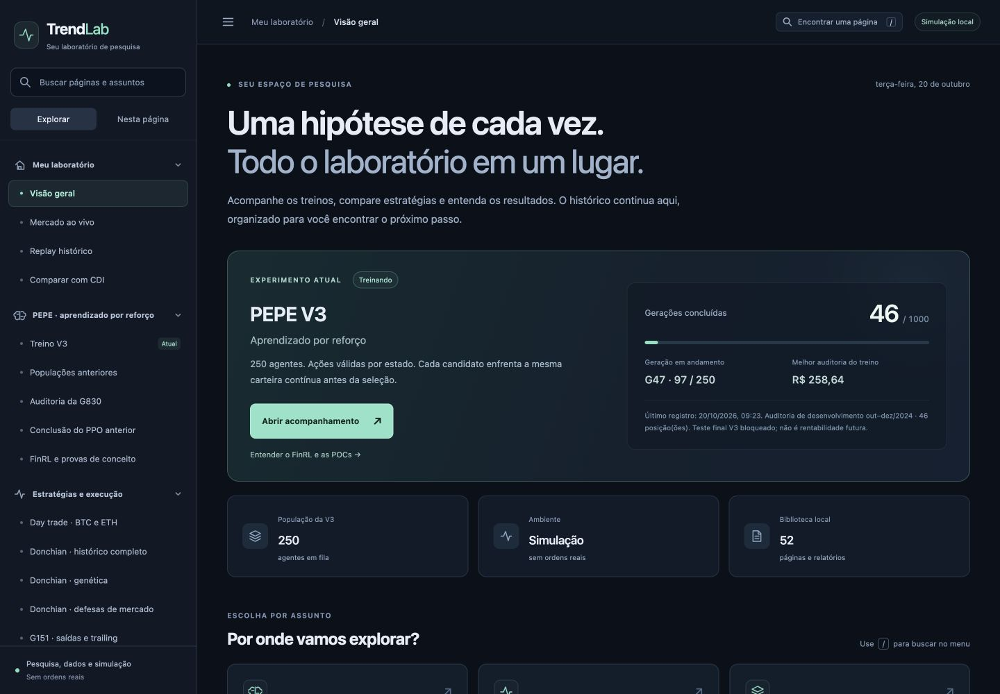
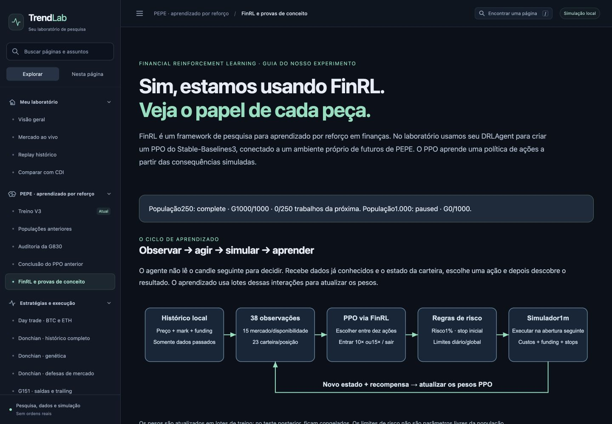

# Interface local do Trend Lab

Refatoração de navegação em20/10/2026. Capturas reais do navegador a1440px; números de treinamento são um retrato do momento. A interface também foi conferida a390px.

[Visão geral local](http://127.0.0.1:4173/) · [método e verificações](../../app/FRONTEND-NAVEGACAO.md).

## Visão geral

## Guia FinRL corrigido

Ícones de navegação limitados a24px; o diagrama mantém sua dimensão própria.

